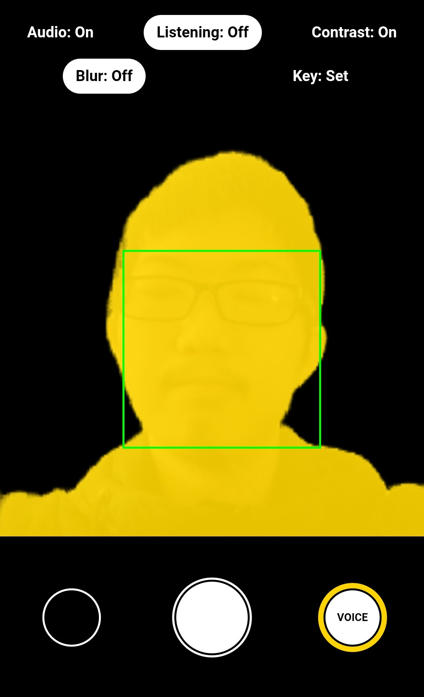

# A Web-Based Guided Selfie Assistant for People with Visual Impairments

[](https://guided-selfie.vercel.app)
[](./A_Web_Based_Guided_Selfie_Assistant_for_People_with_Visual_Impairments_.pdf)

This project aims to enable users to take selfies by talking with the system using natural language. 

A course project for *Accessible Computing* (October to December 2025).

> Note: The live demo is mainly for interface preview. Only Simple Guidance Mode is available. A user key is required to test the Voice Control mode.

## Implemented Prototype

<p align="center">
  
</p>

<p align="center"><sub>Screenshot from an actual run of the prototype.</sub></p>

We designed two modes to let users control how much information they receive:

- **Voice Control Mode**: Users talk with the system in natural language (rather than fixed keywords) to learn about the current frame, or ask it to perform certain tasks (like guiding them to take a selfie, navigating the interface, etc.).

- **Simple Guidance Mode**: Users receive brief and continuous feedback about their position and distance in the frame. Similar to some features in existing tools like Apple's VoiceOver or Google's Guided Frame.

### Example Interaction

#### Asking about the current frame

> **User:** Is there anybody else in the camera view?
> 
> **Assistant (spoken):** Okay let me take a look... no, there is only one person in the photo.

#### Guided capture

> **User:** Can you help me take a selfie? 
>
> **Assistant (spoken):** Do you want me to guide you first or take the photo now? 
>
>**User:** Maybe guide me first.
>
> *The system then provided spoken guidance as the camera moved: "Point the phone down a little. Too close, move the phone further away. Turn the phone slightly to your right. Perfect, your face is centered and at a good distance."*
>
> **User:** Take the photo right now. 
>
> **Assistant (spoken):** Photo taken.

*Selected from an actual prototype run.*

## Motivation

This project is mainly inspired by [Understanding How People with Visual Impairments Take Selfies](https://dl.acm.org/doi/10.1145/3517428.3550372), an interview study with ten participants with visual impairments. This paper examined their selfie-taking challenges and found that existing tools do not give them enough information to take a selfie independently. 

The paper ends with four design guidelines for building accessible selfie systems. The one that shaped this project most was **making selfie guidance feel more like talking to a human**.

By the time we started this project (in October 2025), tools such as
VoiceOver, Seeing AI, Guided Frame, or SelfieX could assist with framing and capture. But we did not identify one that let users ask questions in their own words. This project is an attempt to fill that gap.

## Approach

- We initially designed the low-fi prototype based on user needs we learnt through a **literature review** of previous papers on this topic.

- We then continued to develop the web interfaces and features based on it.

- We did **accessibility inspection** and simulated usability testing on our own first.

- We then conducted **usability testing** with one low-vision participant over Zoom. (We did not manage to do more sessions due to time constraints/difficulty of recruiting.)

> Please refer to the project report for evaluation details.

## System Architecture

Previous work ([“I am uncomfortable sharing what I can't see”: privacy concerns of the visually impaired with camera based assistive applications](https://dl.acm.org/doi/10.5555/3489212.3489321)) has shown that people with visual impairments have a wide range of privacy concerns when using camera-based assistive tools. 

For this reason, we chose to make most computation happen on the **frontend**: 

- Photo storage: IndexedDB (locally in the browser)
- Face detection and segmentation: MediaPipe (locally in the browser)
- Speech features: in-browser VAD + Web Speech API (locality depends on browser implementation)

These computation tasks with other interface interactions are wrapped into different "tools" that can be triggered separately.

The **backend** is where we moved tasks that were not feasible to run on the client side: 

- API proxy: Vercel serverless function (two endpoints, one for text, one for image)
- Database (for user-key validation): Upstash for Redis
- Text and tool use: Google Gemini 2.5 Flash (via OpenRouter)
- Image understanding: our self-hosted VLM (llama.cpp + Cloudflare Tunnel)

> Before finalizing this backend architecture, we also tried other solutions like WASM (Web Assembly) or WebGPU, but neither of them reached a reasonable token speed in the browser. 

> We self-hosted the VLM to avoid sending selfie images to a third-party vision API.


<p align="center">
  
</p>

## Development

```bash
npm install
npm run dev
```

## Deployment (Vercel)

### 1. Connect Storage

In Vercel project dashboard:

- Add **Upstash Redis** (for user keys and rate limiting)
- Add **Edge Config** (for service configuration)

### 2. Environment Variables

| Variable                  | Required | Description                                            |
| ------------------------- | -------- | ------------------------------------------------------ |
| `OPENROUTER_API_KEY`      | Yes      | Your OpenRouter API key                                |
| `VLLM_API_KEY`            | No       | API key for self-hosted VLM server (if applicable)     |
| `CF_ACCESS_CLIENT_ID`     | No       | Cloudflare Access client ID (if VLLM behind CF Access) |
| `CF_ACCESS_CLIENT_SECRET` | No       | Cloudflare Access client secret                        |

<details>
<summary><b>About VLLM_API_KEY and CF_ACCESS_* variables</b></summary>

This project uses a self-hosted VLM to keep selfie images private instead of sending them to external APIs. You can consider different options based on your needs.

Example setup:

- Run [llama.cpp](https://github.com/ggml-org/llama.cpp) server with a vision model on a local machine:
  ```bash
  llama-server -hf Qwen/Qwen3-VL-2B-Instruct-GGUF --api-key "<your-secret>"
  ```
- Expose it via [Cloudflare Tunnel](https://developers.cloudflare.com/cloudflare-one/connections/connect-networks/)
- Protect the endpoint with [Cloudflare Access Service Auth](https://developers.cloudflare.com/cloudflare-one/identity/service-tokens/) (hence the `CF_ACCESS_*` variables)
- Set `VLLM_BASE_URL` in Edge Config to point to your tunnel URL

</details>

### 3. Edge Config Items

| Key                       | Type     | Description                    |
| ------------------------- | -------- | ------------------------------ |
| `SERVICE_ENABLED`         | boolean  | Enable/disable the service     |
| `SERVICE_DISABLED_REASON` | string   | Message shown when disabled    |
| `ALLOWED_MODELS`          | string[] | Allowlist of model IDs         |
| `MAX_TEMPERATURE`         | number   | Max temperature (default: 1.0) |
| `MAX_TOKENS`              | number   | Max tokens (default: 2048)     |
| `VLLM_BASE_URL`           | string   | Self-hosted VLLM endpoint      |
| `RATE_LIMITS`             | object   | `{ per10s, perHour, perDay }`  |

### 4. User Keys

Use the CLI tool to manage user keys:

```bash
# Requires KV_REST_API_URL and KV_REST_API_TOKEN
node scripts/userkeys.mjs create --userId user123
node scripts/userkeys.mjs list --userId user123
node scripts/userkeys.mjs disable --token <token>
```

See [scripts/README.md](scripts/README.md) for full CLI reference.

Users can set their key via `?key=<token>` URL parameter (saved automatically), or click the "Key" button in the app.
